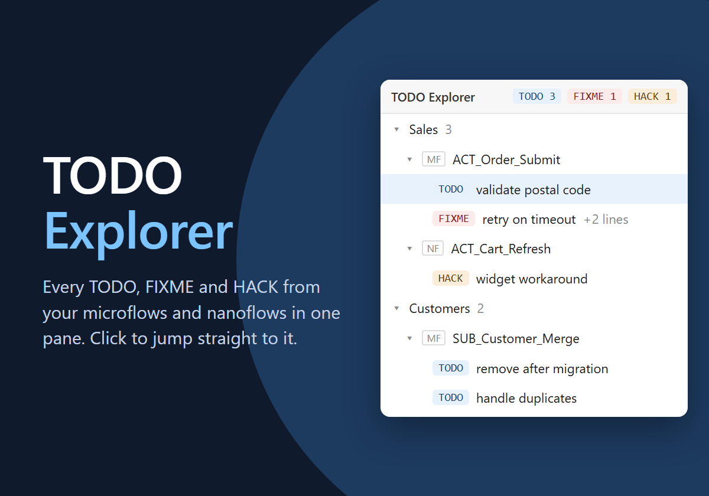

# TODO Explorer
n

A Studio Pro extension that lists every `TODO`, `FIXME` and `HACK` annotation in your microflows and nanoflows in one dockable pane.

Mendix Studio Pro has no built-in overview of annotations, so notes like "TODO: validate input" get lost across hundreds of documents (see the [Idea Forum request](https://community.mendix.com/link/space/studio-pro/ideas/2960)). TODO Explorer collects them, groups them by module and document, and takes you to the exact annotation with one click.

> TODO Explorer is a community project and is not affiliated with or endorsed by Mendix.

## Features

- Dockable pane (Extensions > TODO Explorer), docked at the bottom next to Errors and Console
- Scans microflows and nanoflows, including annotations inside loops
- Tree grouped by module and document, entries sorted by position on the canvas
- Click an entry to open the document with the annotation selected
- Filter by marker and by text; Marketplace modules are hidden by default
- Updates automatically while you edit; Rescan button for a full refresh
- Multi-line annotations show the first line and expand to the full text
- Follows the Studio Pro light/dark theme

Markers are case-sensitive whole words: `TODO: validate input` and `check this FIXME` match, `todo` and `TODOS` don't.

## Requirements

Studio Pro 11.12.1 or later.

## Installation

Install it from the Mendix Marketplace, or import `TodoExplorer.mxmodule` from the [releases](../../releases) via **App Explorer > right-click the app > Import module package**.

## Known limitations

- Markers are fixed to TODO, FIXME and HACK
- Domain model and workflow annotations are not scanned yet
- Built on the Studio Pro Web Extensibility API, which is still in beta

## Development

```bash
npm install
npm test
npm run build -- --app "C:\path\to\your\mendix-app"
```

The build copies the extension to `<app>\extensions\todo-explorer\`. Copy `local.config.example.json` to `local.config.json` to set a default app instead of passing `--app`. Start Studio Pro with `--enable-extension-development` (or enable *Extension Development* in Preferences) to load it, and use **App > Synchronize App Directory** (F4) after rebuilding. F5 in VS Code launches Studio Pro with the debugger attached.

`npm run build -- --release` produces the build used for packaging: no source maps, production React, no development hooks.

### Packaging

The extension ships as an add-on module (`.mxmodule`): a module whose settings have *Export level* = Protected, *Type* = Add-on, *Extension name* = `todo-explorer` and a fixed *Module ID*, exported with `mx create-module-package <app.mpr> TodoExplorer` from Studio Pro 11.12.1 so the package works on that version and later.

## License

[MIT](LICENSE)
